<div align="center">

<table>
<tr>
<td align="center">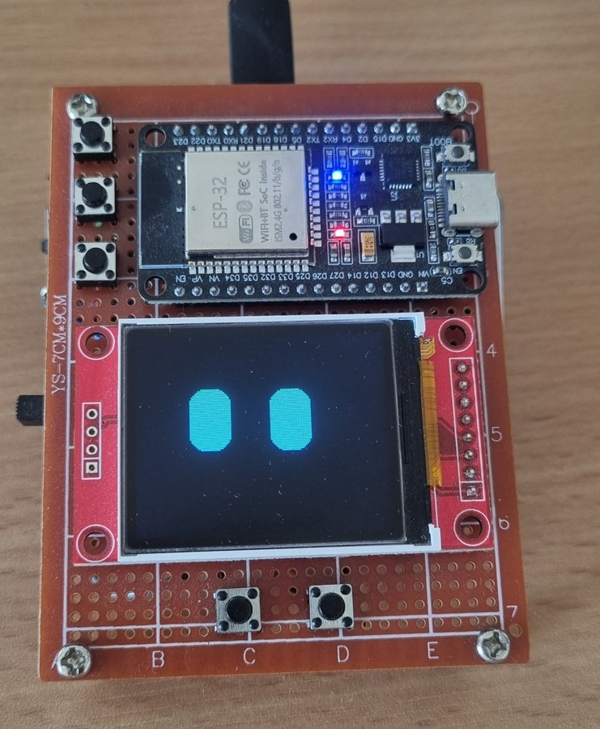<br><sub>📷 A kész eszköz</sub></td>
<td align="center">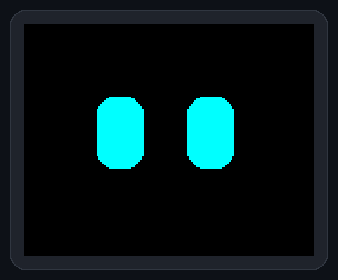<br><sub>👀 ROBI, a Barát</sub></td>
</tr>
</table>

# R.O.B.I.

### **R**adar · **Ó**ra · **B**arát · **I**dőjárás

**Egy kis ESP32-es asztali robot, aki figyel rád, és közben az eget is figyeli.**


[Fotók](#-így-néz-ki-élőben) · [Funkciók](#-funkciók) · [ROBI arcai](#-robi-arcai) · [Gyors indítás](#-gyors-indítás) · [Gombok](#-gombok) · [Hardver](#-hardver) · [Útmutatók](#-részletes-útmutatók) · [Licenc](#-licenc)

</div>

---

## 🤖 Mi ez?

ROBI egy 1.8"-os kijelzős, öt gombos asztali kütyü. Bekapcsolva két animált szem néz vissza rád. Ő a **Barát**: nézelődik, unatkozik, megéhezik, elalszik, játszik veled.

Egy gombnyomásra **repülőradarrá** változik, és élőben hallgathatod rajta a **budapesti Liszt Ferenc reptér toronyrádióját**. Ugyanígy lehet belőle **óra** névnappal vagy **időjárás-állomás**.

- 👀 **Saját személyiség:** napirend, éhség, 3 minijáték, kedves üzenetek, 20 arckifejezés
- ✈️ **Élő légiforgalom:** OpenSky Network adatok + LiveATC rádió egy hangszórón
- 📴 **Net nélkül is megy:** a szemek WiFi nélkül indulnak, a netes programok nem fagynak le
- 🧩 **Egyszerű összerakni:** ESP32 + kijelző + erősítő + 5 gomb, ellenállás sem kell

<div align="center">
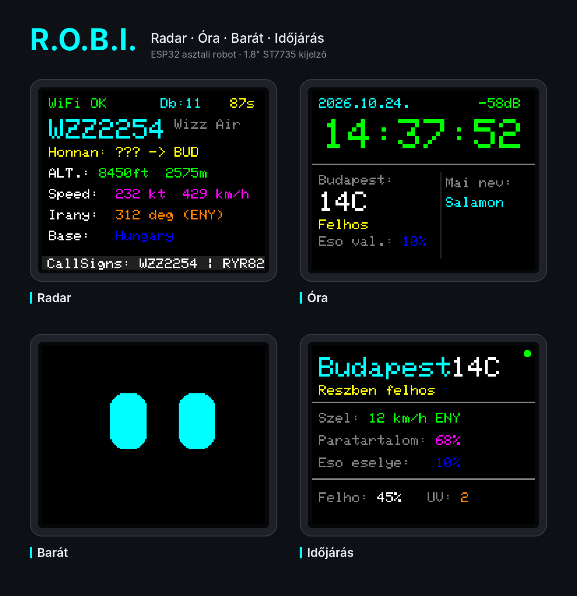
</div>

---

## 📷 Így néz ki élőben

<table>
<tr>
<td align="center" width="50%">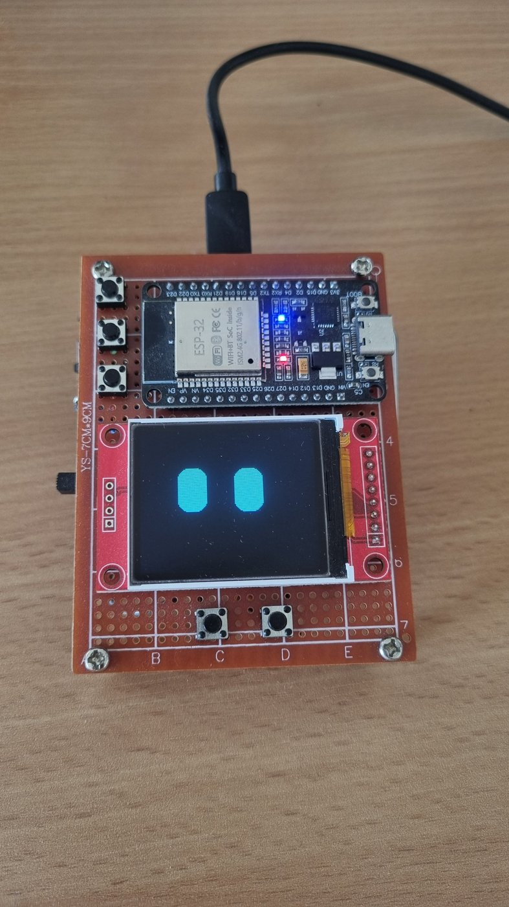<br><sub>Felülről – fent az ESP32 és a 3 programgomb, középen a kijelző, alul a 2 vezérlőgomb</sub></td>
<td align="center" width="50%">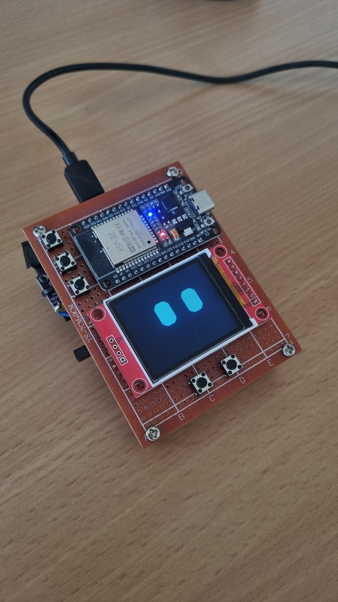<br><sub>A Barát szemei bekapcsolás után</sub></td>
</tr>
<tr>
<td align="center" width="50%">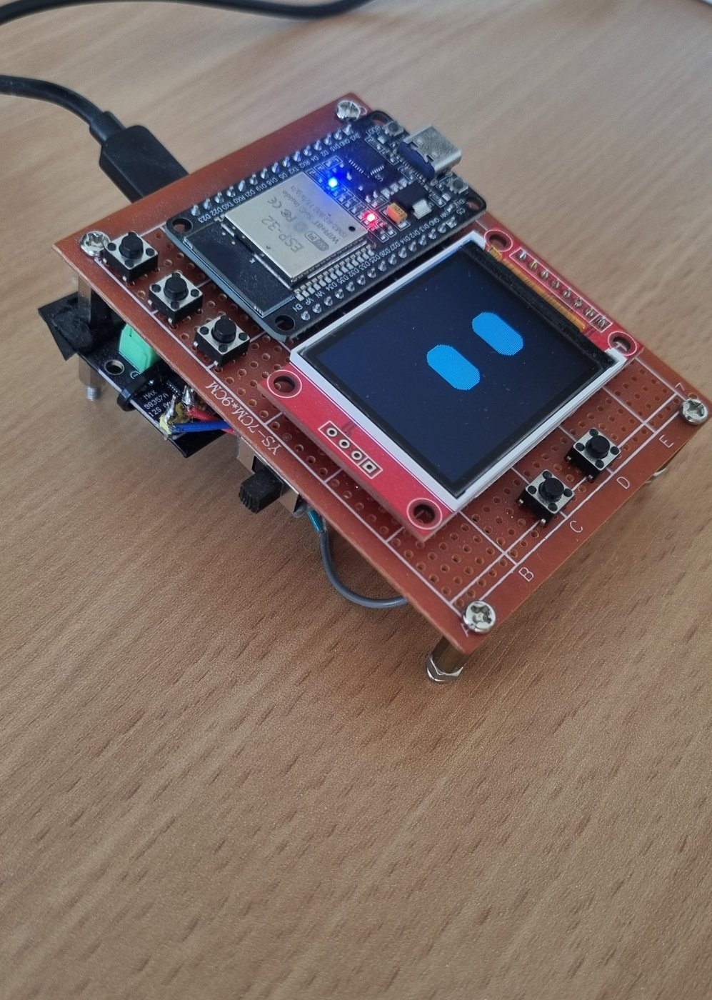<br><sub>Oldalról – a panel alatt a MAX98357 erősítő, oldalt a főkapcsoló</sub></td>
<td align="center" width="50%">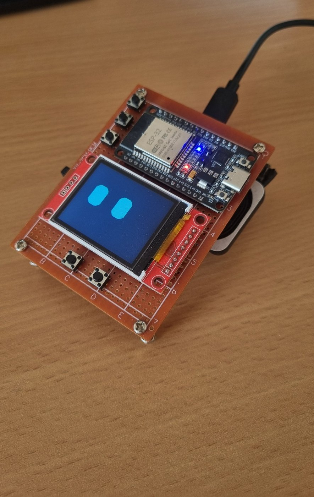<br><sub>Távtartókon áll, hátul alatta a hangszóró</sub></td>
</tr>
</table>

<div align="center"><sub>Az összes fotó: <a href="docs/fotok">docs/fotok</a></sub></div>

---

## ✨ Funkciók

<table>
<tr>
<td width="50%" valign="top">

### ✈️ Repülőradar + ATC rádió
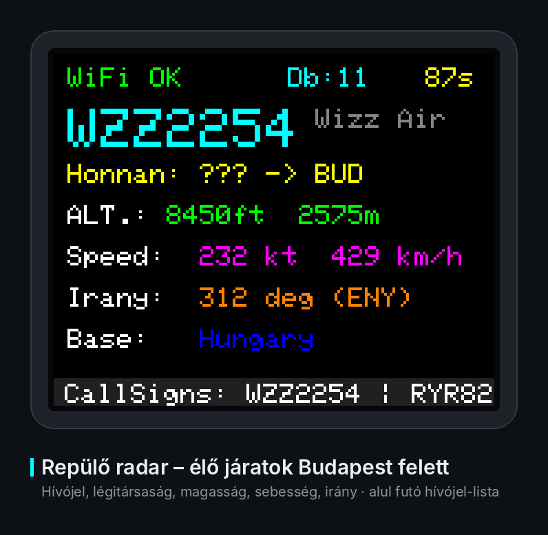

- A környék repülői élőben: hívójel, légitársaság, magasság, sebesség, irány
- **3 oldal:** radar · rádió · fel- és leszállók
- Élő **LHBP** toronyrádió (Approach / Tower / Ground), hangerővel

</td>
<td width="50%" valign="top">

### 🕐 Óra
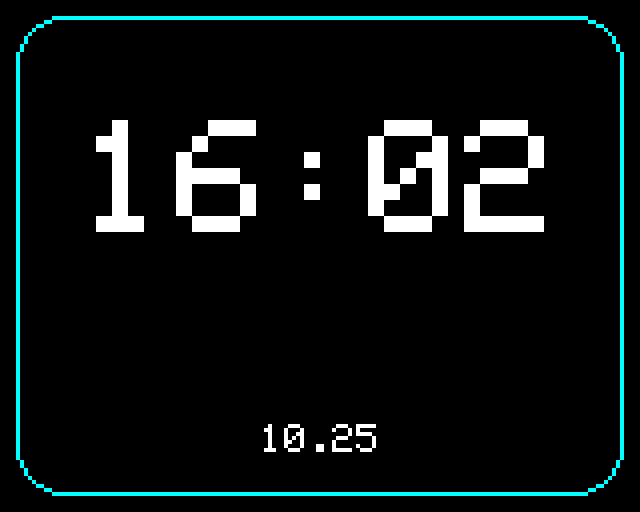

- Pontos idő internetről (NTP), dátum, **névnap**
- Rövid időjárás és WiFi jelerősség
- Egy gombnyomással **nagy óra mód**

</td>
</tr>
<tr>
<td width="50%" valign="top">

### 🌤️ Időjárás
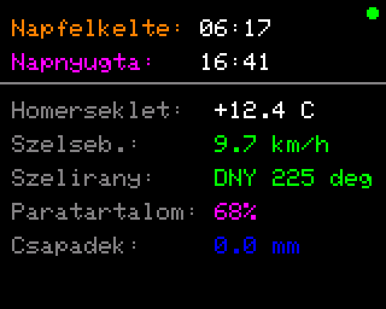

- 3 automatikusan váltakozó képernyő: aktuális adatok · napi részletek · következő napok
- Napkelte és napnyugta, szél, páratartalom, UV, csapadék
- Open-Meteo, API-kulcs nélkül

</td>
<td width="50%" valign="top">

### 👀 Barát
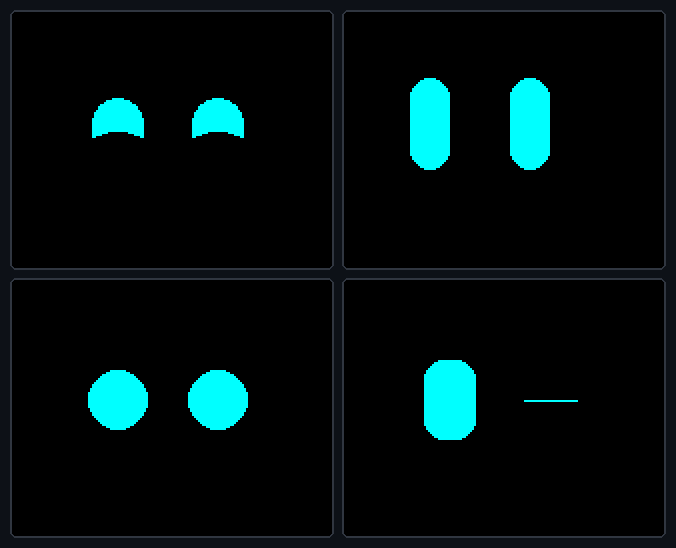
<sub>cuki · kíváncsi · éhes · kacsint</sub>

- Animált szemek, amelyek formát váltanak a hangulat szerint
- Simogatás, etetés, **fej vagy írás**, **reakcióteszt**, **szem-szinkron** játék
- Éjjel alszik, reggel ébred, néha kiírja az időt vagy egy kedves üzenetet

</td>
</tr>
</table>

<details>
<summary><b>📸 További képernyők</b></summary>
<br>

| Rádió oldal | Fel- és leszállók | Hangerő | Csatornaváltás |
|:---:|:---:|:---:|:---:|
| 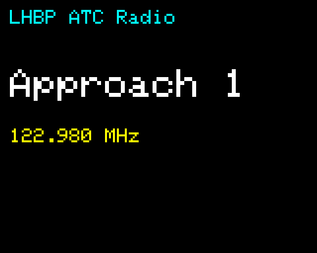 | 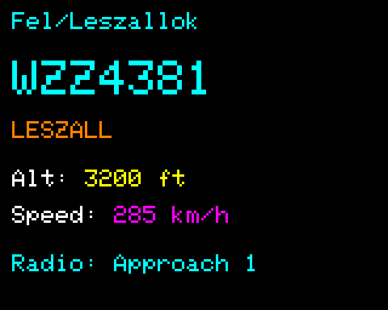 | 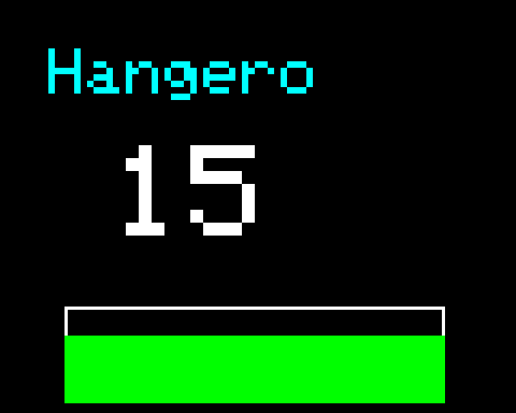 | 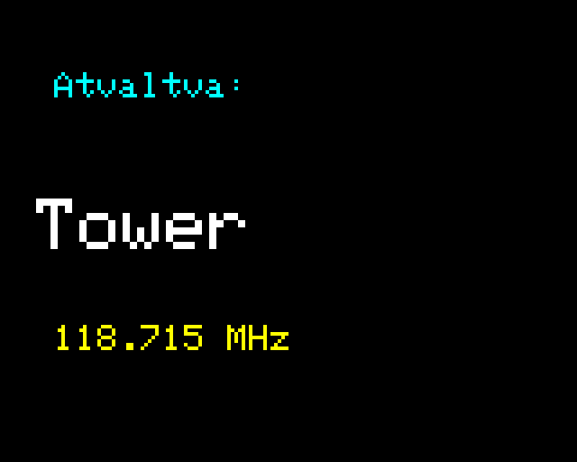 |

| Következő napok | Indulóképernyő |
|:---:|:---:|
| 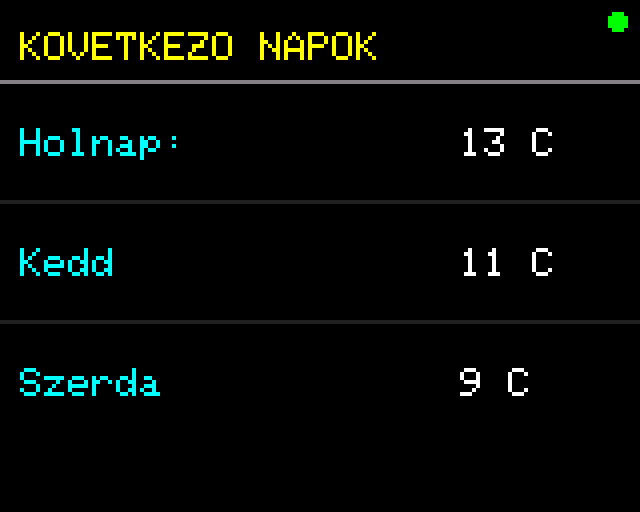 | 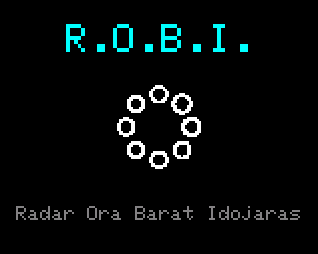 |

</details>

---

## 👀 ROBI arcai

<div align="center">
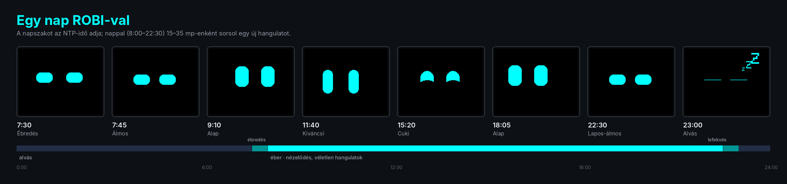
</div>

<details>
<summary><b>Mind a 20 arckifejezés, és hogy mikor jelenik meg</b></summary>
<br>
<div align="center">
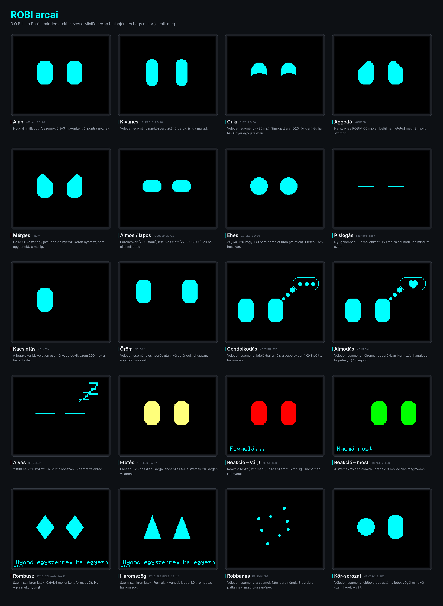
</div>
</details>

---

## ⚙️ Hogyan működik?

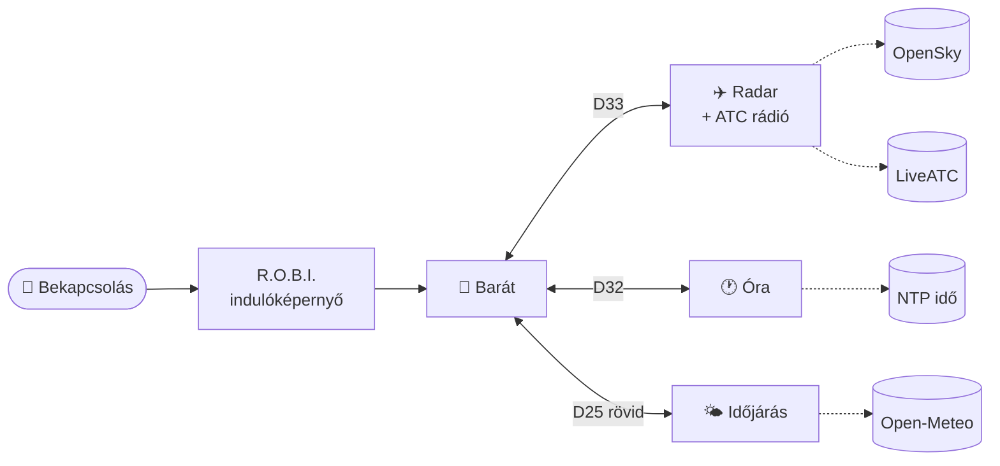

Egyszerre mindig egy program fut. Váltáskor egy rövid animáció után a választott program tisztán, elölről indul. Bármelyikből vissza lehet jutni a szemekhez a **D25 hosszú** nyomásával.

---

## 🚀 Gyors indítás

> Részletesen, képekkel: [Beüzemelési útmutató (PDF)](docs/ROBI_Beuzemelesi_utmutato_szoftver.pdf)

1. **Rakd össze** a hardvert a [bekötési útmutató](docs/ROBI_Osszeszerelesi_utmutato.pdf) alapján.
2. **Arduino IDE 2.x** → Boards Manager → **esp32 by Espressif 3.3.8**.
3. **Könyvtárak:**
   - a Library Managerből: Adafruit GFX (1.13.0), Adafruit ST7735 and ST7789 (1.12.0), ArduinoJson (7.4.2);
   - ZIP-ből: [**ESP32-audioI2S 3.2.1**](https://github.com/schreibfaul1/ESP32-audioI2S/releases/tag/3.2.1). Pontosan ez a verzió kell.
4. **WiFi:** a `MainLauncher` mappában másold le a `secrets.example.h`-t **`secrets.h`** néven, és írd bele:
   ```cpp
   #define SECRET_WIFI_SSID      "a_wifid_neve"     // csak 2,4 GHz!
   #define SECRET_WIFI_PASSWORD  "a_wifid_jelszava"
   ```
5. **Feltöltés:** Board: *ESP32 Dev Module* · Partition Scheme: **Huge APP (3MB No OTA)** · Upload ✅

Bekapcsolás után ROBI szemei néznek vissza rád. 🎉

**Saját beállítások** – mind a [`config.h`](MainLauncher/config.h)-ban:

| Mit | Alapérték |
|---|---|
| Időjárás helye (`CFG_CITY_NAME`, `CFG_WEATHER_LAT/LON`) | Budapest |
| Radar figyelt területe (`CFG_RADAR_LAMIN` … `LOMAX`) | Budapest + Liszt Ferenc reptér |
| ATC csatornák (`CFG_ATC_CHANNELS`) – új link: [LiveATC](https://www.liveatc.net/search/?icao=LHBP) → *Listen* | LHBP Approach / Tower / Ground |

---

## 🎮 Gombok

| Gomb | 👀 Barát | ✈️ Radar | 🕐 Óra | 🌤️ Időjárás |
|:---:|---|---|---|---|
| **D33** | → Radar | újraindítás | → Radar | → Radar |
| **D32** | → Óra | → Óra | újraindítás | → Óra |
| **D25** | rövid → Időjárás | rövid → Időjárás · *hosszú → Barát* | rövid → Időjárás · *hosszú → Barát* | rövid: újraindítás · *hosszú → Barát* |
| **D26** | simogatás · *hosszan: etetés / ébresztés* | következő oldal · *hosszan: hangerő –* | nagy óra mód | – |
| **D27** | játékok · *hosszan: idő / üzenet / időjárás* | következő csatorna · *hosszan: hangerő +* | – | – |

---

## 🔧 Hardver

| Alkatrész | Típus |
|---|---|
| Mikrovezérlő | ESP32 WROOM-32 dev board (PSRAM nem kell) |
| Kijelző | ST7735 1.8" TFT, 160×128, SPI |
| Hangerősítő | MAX98357 I2S modul |
| Hangszóró | 4 Ω, 3 W |
| Egyéb | 5 nyomógomb, 220 µF kondenzátor, kapcsoló, USB-C táppanel |

<details>
<summary><b>📌 Lábkiosztás</b></summary>

| Modul | Láb → GPIO |
|---|---|
| Kijelző | CS 5 · RST 4 · DC 2 · MOSI 23 · SCK 18 · VCC 3.3V |
| Erősítő | BCLK 14 · LRC 13 · DIN 21 · VIN 5V · SD 3.3V |
| Gombok (GPIO ↔ GND) | D33 · D32 · D25 · D26 · D27 – belső felhúzó, ellenállás nem kell |

</details>

---

## 📚 Részletes útmutatók

<table>
<tr>
<td align="center" width="50%">
<a href="docs/ROBI_Osszeszerelesi_utmutato.pdf">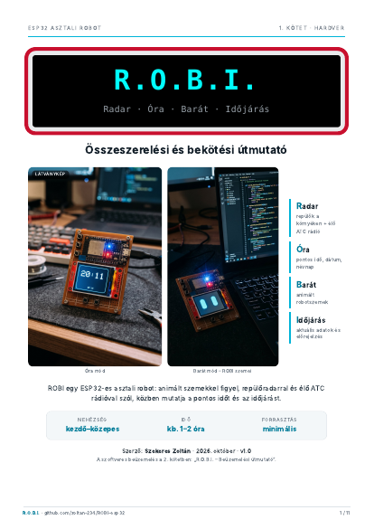</a><br>
<b><a href="docs/ROBI_Osszeszerelesi_utmutato.pdf">Összeszerelési és bekötési útmutató</a></b><br>
<sub>alkatrészek · tervrajz · bekötés lépésenként · ellenőrzőlista</sub>
</td>
<td align="center" width="50%">
<a href="docs/ROBI_Beuzemelesi_utmutato_szoftver.pdf">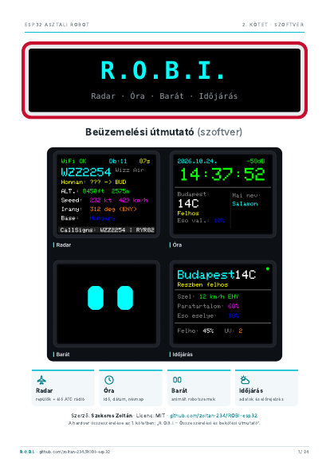</a><br>
<b><a href="docs/ROBI_Beuzemelesi_utmutato_szoftver.pdf">Beüzemelési útmutató (szoftver)</a></b><br>
<sub>letöltések · könyvtárverziók · beállítások · gombok · hibaelhárítás</sub>
</td>
</tr>
</table>

---

## 📁 Felépítés

```
MainLauncher/
├─ MainLauncher.ino     launcher: gombok, programváltás, indulóképernyő
├─ config.h             ⚙️ beállítások: helyszín, radar terület, ATC csatornák
├─ secrets.example.h    🔒 minta a WiFi adatokhoz (→ secrets.h, nem kerül fel GitHubra)
├─ WifiGuard.h          WiFi időkorláttal, „Nincs WiFi” képernyő
├─ RadarApp.h           ✈️ repülőradar + ATC rádió
├─ OraApp.h             🕐 óra
├─ IdojarasApp.h        🌤️ időjárás
├─ MiniFaceApp.h        👀 Barát (szemek)
└─ MiniFaceTypes.h, SpinnerFrames.h
docs/                   PDF útmutatók, képek
docs/fotok/             📷 valódi fotók a kész eszközről
```

---

## 📜 Licenc

ROBI a **[PolyForm Noncommercial 1.0.0](LICENSE)** licenc alatt érhető el.

| ✅ Szabad | ❌ Nem szabad |
|---|---|
| használni, megépíteni, otthon, iskolában, hobbiból | eladni az eszközt vagy a kódot |
| másolni és továbbadni | pénzért szolgáltatást vagy terméket építeni rá |
| módosítani, saját változatot készíteni | kereskedelmi célra bármilyen formában felhasználni |

Továbbadáskor a licencet és a szerző nevét meg kell tartani. A felhasznált könyvtárak (Adafruit GFX/ST7735 – BSD, ArduinoJson – MIT, ESP32-audioI2S – GPL-3.0) a saját licencük alá tartoznak.

---

## 🙏 Köszönet

[Adafruit GFX & ST7735](https://github.com/adafruit/Adafruit-GFX-Library) · [ArduinoJson](https://arduinojson.org) · [ESP32-audioI2S](https://github.com/schreibfaul1/ESP32-audioI2S) · [OpenSky Network](https://opensky-network.org) · [Open-Meteo](https://open-meteo.com) · [LiveATC.net](https://www.liveatc.net)

<div align="center">
<br>
<sub>Készítette <b>Szekeres Zoltán</b> · <a href="LICENSE">PolyForm Noncommercial 1.0.0</a> – kereskedelmi célra nem használható</sub><br>
<sub>Ha tetszik ROBI, adj neki egy ⭐-ot!</sub>
</div>
